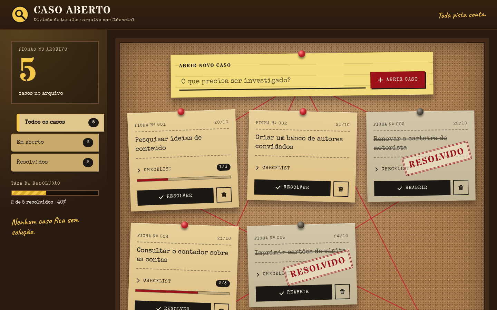

<div align="center">

# To-Do List Detetive

**Lista de tarefas com tema de investigação: cada tarefa é um caso, preso num quadro de cortiça.**

[](https://to-do-list-detetive.vercel.app)
[](https://trello.com/b/rmZWN3fj/to-do-list-detetive)




</div>

## Sobre

Aplicação de lista de tarefas feita para a atividade de Next.js. Cada tarefa vira uma **ficha** numerada, presa por um pino vermelho num quadro de cortiça com barbante. Ao resolver, a ficha ganha um carimbo, o texto é riscado e o pino fica cinza.

O tema detetive aparece em tudo: tarefa é *caso*, a lista é o *arquivo* e excluir é *destruir ficha*.

## Links

| | |
|---|---|
| Site publicado | https://to-do-list-detetive.vercel.app |
| Quadro de tarefas (Trello) | [To-Do List Detetive](https://trello.com/b/rmZWN3fj/to-do-list-detetive) |

## O que tem na página

- **Abrir novo caso** por formulário, com aviso quando o título está vazio
- **Resolver ou reabrir** uma ficha
- **Descartar** uma ficha, com confirmação na própria ficha
- **Checklist** dentro de cada ficha, no estilo do Trello: adicionar, marcar e remover itens, com contador e barra de progresso
- **Filtros** Todos, Em aberto e Resolvidos, cada um com a sua contagem
- **Contador** de fichas e barra de taxa de resolução
- **Estados vazios** diferentes para cada filtro
- **Persistência** em `localStorage`: tudo continua depois de recarregar a página
- Layout responsivo e navegação por teclado com foco visível

## Tecnologias

- [Next.js 16](https://nextjs.org) (App Router) e [React 19](https://react.dev)
- [TypeScript](https://www.typescriptlang.org)
- [Tailwind CSS 4](https://tailwindcss.com)
- ESLint
- Vercel (hospedagem)

## Como rodar

Pré-requisito: Node.js 20 ou superior.

```bash
npm install
npm run dev     # desenvolvimento em http://localhost:3000
npm run lint    # lint
npm run build   # build de produção
```

## Estrutura

```text
src/
  app/                  layout, página, metadata, favicon e tokens do tema
  components/
    layout/             header e footer
    sections/tasks/     quadro de tarefas (estado, ficha, checklist, formulário, filtros)
    ui/                 Button e Pin, componentes genéricos
  content/              textos e fichas de exemplo
  lib/                  utilitários, store do localStorage e hook useTasks
  types/                tipos compartilhados
docs/architecture/      regras de arquitetura do projeto
docs/images/            imagens do README
```

A página é montada em `src/app/page.tsx`, que só compõe as seções. Os textos ficam em `src/content` e os componentes só cuidam da apresentação. As regras completas estão em [`docs/architecture`](docs/architecture/feature.spec.md).

## Publicação

O site é publicado na Vercel, ligada a este repositório: cada push na `main` gera um novo deploy de produção.

## Time

| | |
|---|---|
| [@dutrathiagodev](https://github.com/dutrathiagodev) | Design, arquitetura, desenvolvimento e publicação |

O trabalho foi dividido em cards no Trello, um por Pull Request, com commits convencionais (`feat`, `docs`, `chore`).
